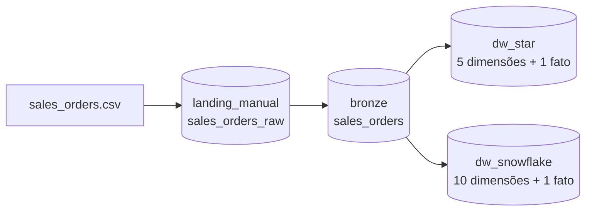

# Data Warehouse de Vendas: Star Schema vs Snowflake Schema

Projeto de Engenharia de Dados que constrói um **Data Warehouse de vendas** do zero no **Databricks** e implementa o **mesmo modelo de negócio em duas modelagens dimensionais**: **Star Schema** e **Snowflake Schema**. O objetivo é comparar, na prática, como cada abordagem organiza as dimensões, o impacto na redundância dos dados e no número de joins das consultas analíticas.

---

## Sumário

- [Visão geral](#visão-geral)
- [Arquitetura](#arquitetura)
- [Tecnologias](#tecnologias)
- [Estrutura do repositório](#estrutura-do-repositório)
- [Dataset](#dataset)
- [Pipeline de dados](#pipeline-de-dados)
- [Modelagem Star Schema](#modelagem-star-schema)
- [Modelagem Snowflake Schema](#modelagem-snowflake-schema)
- [Star vs Snowflake](#star-vs-snowflake)
- [Exemplo de consulta analítica](#exemplo-de-consulta-analítica)
- [Como executar](#como-executar)
- [Decisões de projeto](#decisões-de-projeto)
- [Próximos passos](#próximos-passos)
- [Autor](#autor)

---

## Visão geral

A partir de um único arquivo CSV de pedidos (`sales_orders.csv`), o projeto:

1. Ingere os dados brutos em uma camada **landing**.
2. Padroniza tipos e calcula métricas na camada **bronze**.
3. Modela o DW em dois schemas separados, **`dw_star`** e **`dw_snowflake`**, a partir da mesma tabela bronze.
4. Compara as duas abordagens com a mesma pergunta de negócio.

O **grão** da tabela fato é **um item de pedido** (`order_id` + `order_item_id`).

## Arquitetura



Todo o projeto vive no catálogo **`proj_dw`** do Unity Catalog, usando o namespace de três níveis (`catalogo.schema.tabela`):

| Schema | Papel |
|---|---|
| `landing_manual` | Recebe o CSV original (volume `input`) e a tabela `sales_orders_raw`, cópia fiel do arquivo |
| `bronze` | Tabela `sales_orders` com schema explícito (cast de tipos) e métricas calculadas |
| `dw_star` | Modelo dimensional em estrela |
| `dw_snowflake` | Modelo dimensional em floco de neve (dimensões normalizadas) |

## Tecnologias

- **Databricks** (notebooks, Unity Catalog, Volumes)
- **Delta Lake** (formato das tabelas)
- **Spark SQL** (DDL, transformações e consultas)
- **Python** (geração do dataset sintético)
- **dbdiagram.io** (diagramas ER dos dois modelos)

## Estrutura do repositório

```text
Datawarehouse-Project/
├── files/
│   └── sales_orders.csv                 # dataset de vendas (1.000 linhas)
├── setup/
│   ├── create_data.ipynb                # gera o CSV sintético (seed fixa)
│   └── config_schemas.ipynb             # cria catálogo, schemas e camadas landing/bronze
└── modeling/
    ├── star/
    │   ├── star_schema.ipynb            # dimensões e fato do modelo estrela
    │   ├── dbdiagramCodeStar.txt        # código do diagrama (dbdiagram.io)
    │   └── dbdiagramIO.png              # diagrama ER
    └── snowflake/
        ├── snowflake_schema.ipynb       # dimensões e fato do modelo snowflake
        ├── dbdiagramCodeSnowflake.txt   # código do diagrama (dbdiagram.io)
        └── dbdiagramIO.png              # diagrama ER
```

## Dataset

Dataset **sintético** de vendas de varejo, gerado por `setup/create_data.ipynb`.

| Característica | Valor |
|---|---|
| Linhas (itens de pedido) | 1.000 |
| Pedidos distintos | 326 |
| Clientes | 10 |
| Produtos | 15 (6 categorias, 12 subcategorias, 14 marcas) |
| Lojas | 5 (SP, RJ, MG, PR, RS) |
| Período | 01/01/2024 a 31/12/2024 |
| Formas de pagamento | Pix, Cartão de Crédito, Cartão de Débito, Boleto |
| Status de pagamento | Aprovado, Pendente, Cancelado |

## Pipeline de dados

### 1. Landing

O CSV é carregado em um volume do Unity Catalog e lido com `read_files`, gerando `landing_manual.sales_orders_raw` sem nenhuma transformação.

### 2. Bronze

`bronze.sales_orders` é criada com **cast explícito de cada coluna**. Ao ler CSV, o Spark pode inferir tipos errados (principalmente em colunas string), então o schema é declarado na mão. Nessa etapa também são calculadas duas métricas:

```sql
total_gross = unit_price * quantity
total_net   = (unit_price * quantity) - discount_value
```

### 3. Camada dimensional

Cada dimensão é criada com **surrogate key** (`BIGINT GENERATED ALWAYS AS IDENTITY`) e populada com `SELECT DISTINCT` a partir da bronze. A tabela fato é montada com joins entre a bronze e as dimensões, trocando as chaves naturais pelas surrogate keys.

## Modelagem Star Schema

Uma tabela fato central cercada por dimensões **desnormalizadas**.


| Tabela | Tipo | Descrição |
|---|---|---|
| `fact_order_items` | Fato | Um item de pedido: chaves das dimensões + `quantity`, `unit_price`, `discount_value`, `total_gross`, `total_net` |
| `dim_date` | Dimensão | Data, ano, mês, dia e nome do mês |
| `dim_customer` | Dimensão | Dados cadastrais, cidade e estado do cliente |
| `dim_product` | Dimensão | Produto com **categoria, subcategoria e marca na mesma tabela** |
| `dim_store` | Dimensão | Loja com **cidade e estado na mesma tabela** |
| `dim_payment` | Dimensão | Forma de pagamento, parcelas e status |

## Modelagem Snowflake Schema

Mesma tabela fato, mas as dimensões de **produto** e **loja** são **normalizadas em hierarquias**.


| Hierarquia | Tabelas |
|---|---|
| Produto | `dim_product` → `dim_subcategory` → `dim_category` e `dim_product` → `dim_brand` |
| Loja | `dim_store` → `dim_city` → `dim_state` |
| Compartilhadas com o star | `dim_date`, `dim_customer`, `dim_payment` |

## Star vs Snowflake

| Aspecto | Star | Snowflake |
|---|---|---|
| Tabelas no modelo | 6 (5 dimensões + 1 fato) | 11 (10 dimensões + 1 fato) |
| Tabela fato | Idêntica | Idêntica |
| Dimensões | Desnormalizadas | Normalizadas em hierarquias |
| Redundância | Maior: atributos como a marca se repetem em todos os produtos | Menor: cada atributo é armazenado uma vez |
| Manutenção de atributos | Atualiza várias linhas | Atualiza em um único lugar |
| Extensão da dimensão | Novos atributos de marca replicam em todos os produtos da marca | Só a `dim_brand` ganha colunas ou linhas |
| Joins nas consultas | Menos | Mais |
| Complexidade do modelo e do ETL | Menor | Maior |
| Uso típico em BI | Geralmente preferido pela simplicidade das consultas | Útil quando a redundância ou a manutenção das dimensões pesa mais |

## Autor

**Leonardo Lopes Prado**
Estudante de Engenharia de Software no Inatel, com foco em Engenharia de Dados.

[](https://github.com/LeoLPrado)
[](https://linkedin.com/in/leonardo-lprado)
